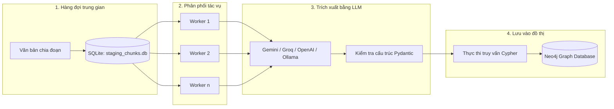

# Text2Triple

Text2Triple là công cụ xử lý dữ liệu phục vụ trích xuất thông tin từ tài liệu *Lịch sử Việt Nam (15 tập)* sang cơ sở dữ liệu đồ thị Neo4j. Hệ thống nhận các đoạn văn bản, sử dụng mô hình ngôn ngữ lớn (LLM) để trích xuất các thực thể và mối quan hệ theo cấu trúc định sẵn, sau đó tự động lưu vào đồ thị.

---

## Luồng xử lý dữ liệu

## Cấu trúc Thực thể và Quan hệ

Hệ thống trích xuất dữ liệu theo danh mục thực thể và quan hệ sau:

### Danh sách Thực thể

| Loại thực thể | Ý nghĩa | Ví dụ |
| :--- | :--- | :--- |
| `Person` | Nhân vật lịch sử (vua chúa, tướng lĩnh, sứ thần, danh nhân) | Ngô Quyền, Trần Hưng Đạo, Nguyễn Trãi |
| `Event` | Sự kiện, chiến dịch quân sự, trận đánh, khởi nghĩa, hội nghị | Trận Bạch Đằng (938), Hội nghị Diên Hồng |
| `Location` | Địa danh, sông núi, thành quách, đơn vị hành chính | Sông Bạch Đằng, Thành Cổ Loa, Hoa Lư |
| `DynastyEra` | Triều đại, nhà nước hoặc thời kỳ lịch sử | Nhà Đinh, Đại Cồ Việt, Thời Bắc thuộc |
| `TimePeriod` | Niên hiệu, mốc thời gian, thế kỷ, năm tháng cụ thể | Năm 938, Thế kỷ X, Niên hiệu Thái Bình |
| `Organization` | Triều đình, quân đội, bộ chỉ huy, tổ chức chính trị | Quân đội Nam Hán, Triều đình Tiền Lê |
| `WeaponTactic` | Vũ khí, phương tiện tác chiến hoặc chiến thuật quân sự | Cọc nhọn bịt sắt, Hỏa công, Đóng cọc lòng sông |
| `DocumentPolicy` | Văn kiện chính trị, chiếu chỉ, sắc lệnh, hiệp ước, luật pháp | Chiếu Dời Đô, Luật Hồng Đức, Bình Ngô Đại Cáo |
| `Concept` | Tư tưởng, học thuyết, khái niệm tôn giáo hoặc xã hội | Nho giáo, Tư tưởng thân dân, Ý thức độc lập |

### Danh sách Quan hệ

| Tên quan hệ | Thực thể nguồn | Thực thể đích | Ý nghĩa liên kết |
| :--- | :--- | :--- | :--- |
| `LANH_DAO` | `Person`, `Organization` | `Event` | Chỉ huy, tổ chức hoặc lãnh đạo sự kiện |
| `SU_DUNG` | `Person`, `Organization` | `WeaponTactic`, `Location` | Sử dụng vũ khí, chiến thuật hoặc lợi dụng địa hình |
| `DIEN_RA_TAI` | `Event` | `Location` | Sự kiện diễn ra tại địa danh cụ thể |
| `THAM_GIA` | `Person`, `Organization`, `DynastyEra` | `Event` | Lực lượng, cá nhân hoặc triều đại tham gia sự kiện |
| `THANH_LAP` | `Person`, `Organization`, `DynastyEra` | `Organization`, `Location`, `DynastyEra`, `Event`, `DocumentPolicy` | Sáng lập triều đại, tổ chức hoặc xây dựng công trình |
| `BAN_HANH` | `Person`, `Organization`, `DynastyEra` | `DocumentPolicy` | Ban hành sắc lệnh, luật lệ, văn kiện |
| `KE_VI` | `Person`, `DynastyEra` | `Person`, `DynastyEra` | Kế nhiệm ngôi vị hoặc triều đại mới thay thế triều đại cũ |
| `THUOC_VE` | `Location`, `Organization`, `Person` | `Location`, `Organization`, `DynastyEra` | Quan hệ phân cấp hành chính hoặc đơn vị trực thuộc |
| `DAN_DEN` | `Event`, `DocumentPolicy`, `Concept` | `Event`, `Concept`, `DocumentPolicy` | Mối liên hệ nhân quả trực tiếp giữa các sự kiện hoặc chính sách |
| `DIEN_RA_VAO` | `Event`, `DynastyEra`, `DocumentPolicy` | `TimePeriod`, `DynastyEra` | Gắn sự kiện hoặc văn kiện với mốc thời gian tương ứng |
